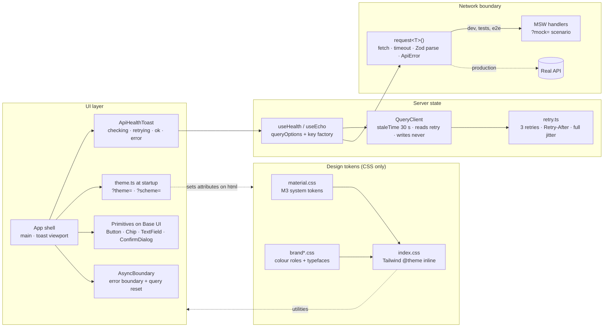
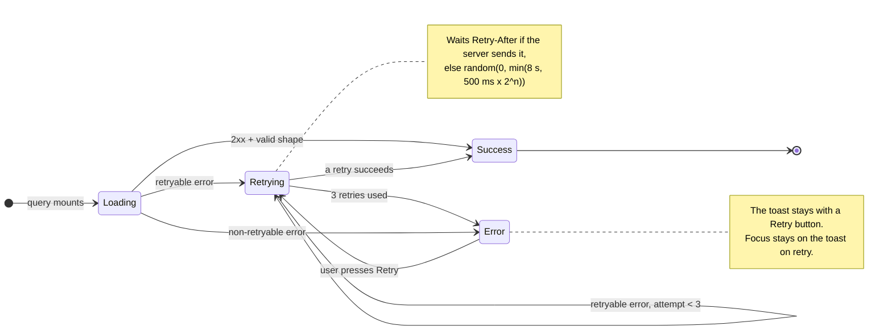
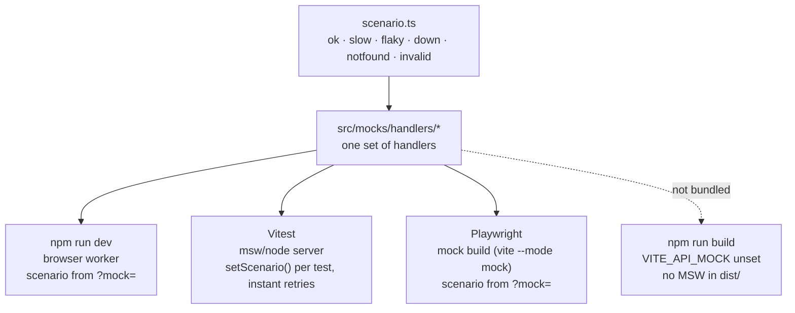
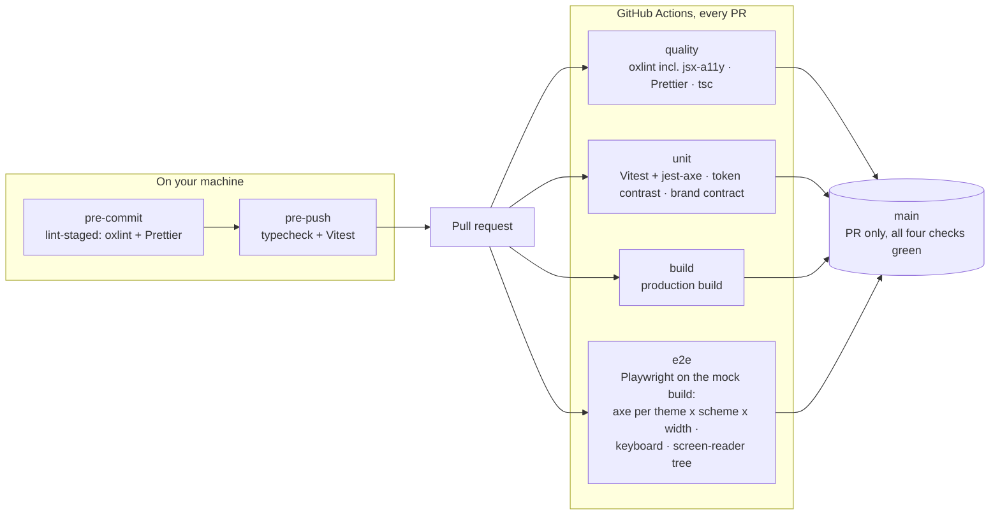
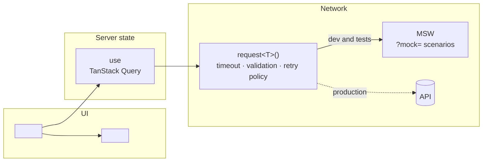

# Architecture: worked example

This page draws the architecture this template ships with. It is meant to be copied: each diagram
is followed by a note on what it shows, what it leaves out, and what to change when you adapt it
for your own project. Mermaid renders on GitHub and in most editor previews, so there is no export
step.

The four diagrams answer four different questions. Keep the ones your reader needs and delete the
rest. Two small diagrams are easier to read than one large one.

1. [Components and data flow](#1-components-and-data-flow): what calls what.
2. [Request lifecycle](#2-request-lifecycle): what the user sees while a read is in flight.
3. [Where the mock API runs](#3-where-the-mock-api-runs): one set of handlers, four environments.
4. [Quality gates](#4-quality-gates): what runs before code reaches `main`.

## 1. Components and data flow

**What it shows.** Four layers with one job each. Components never call `fetch`. They call a hook,
the hook calls `request()`, and `request()` is the only code that talks HTTP. Every failure leaves
`request()` as an `ApiError` that already knows whether it is retryable, so the retry policy never
inspects raw responses. Theming is CSS only: `?theme=` and `?scheme=` set two attributes on `<html>`
at startup, and no component re-renders for it.

**What it leaves out.** Individual primitives, the test harness, and the build. Those are in
`docs/template-guide.md`.

**To adapt it.** Replace `useHealth / useEcho` with your resource hooks. Add your screen to the UI
layer and draw only the components that carry a decision a reviewer would ask about. If you have
a real backend, make the production edge solid and the MSW edge dotted.

## 2. Request lifecycle

**What it shows.** The read path as the user experiences it, which is what the health toast shows.
Retryable means a network error, a timeout, HTTP 408, 425, 429 or any 5xx. A 404, another 4xx, or a
response that fails schema validation goes straight to Error, because retrying cannot fix it.

**What it leaves out.** Writes. Mutations are never retried automatically because they are not
idempotent; the UI offers an explicit Retry instead. Add a second, smaller diagram if your
screen has an important write.

**To adapt it.** If your domain has its own states (draft, submitted, approved), draw those
instead and keep this one only if loading and error behaviour is part of the story you are
telling.

## 3. Where the mock API runs

**What it shows.** Mocking happens at the network layer, not inside components. The same handlers
answer the dev server, the unit tests and the browser tests, so a scenario you can see at
`/?mock=flaky` is the same one a test asserts on. In a production build the mock code is not in
the bundle at all.

| Scenario   | Response                                  | Exercises                    |
| ---------- | ----------------------------------------- | ---------------------------- |
| `ok`       | Normal responses                          | Success state                |
| `slow`     | 2 s latency                               | Loading state, live region   |
| `flaky`    | Two 503s per endpoint, then recovers      | Retry counter, recovery      |
| `down`     | Always 503 with `Retry-After: 1`          | Error state, Retry button    |
| `notfound` | Always 404                                | Non-retryable error          |
| `invalid`  | 200 with a body that fails the Zod schema | Validation error, no retries |

**To adapt it.** Usually unchanged. Add your resource's handler file under the handlers box if
you want to name it.

## 4. Quality gates

**What it shows.** The test pyramid as gates. Cheap static checks run first and on every commit;
browser tests run in CI against a build with the mock API, so they can drive loading and error
states from the URL. The four CI jobs run in parallel, and `main` accepts a change only when all
four are green.

**What it leaves out.** What automation cannot check: real screen-reader speech, 400% zoom, and
content quality. `docs/template-guide.md` lists those under accessibility.

**To adapt it.** Keep it if your reader cares about how quality is enforced. Drop it from a
diagram aimed at product or design readers.

## Blank starting point

Copy this into your own `docs/architecture.md` and fill in the angle brackets.

Under each diagram, write one line on what it shows and one on what it leaves out. A reader
trusts a diagram more when it says what is missing.
