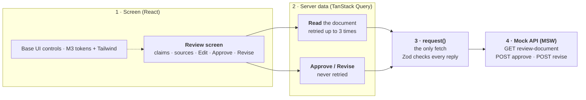
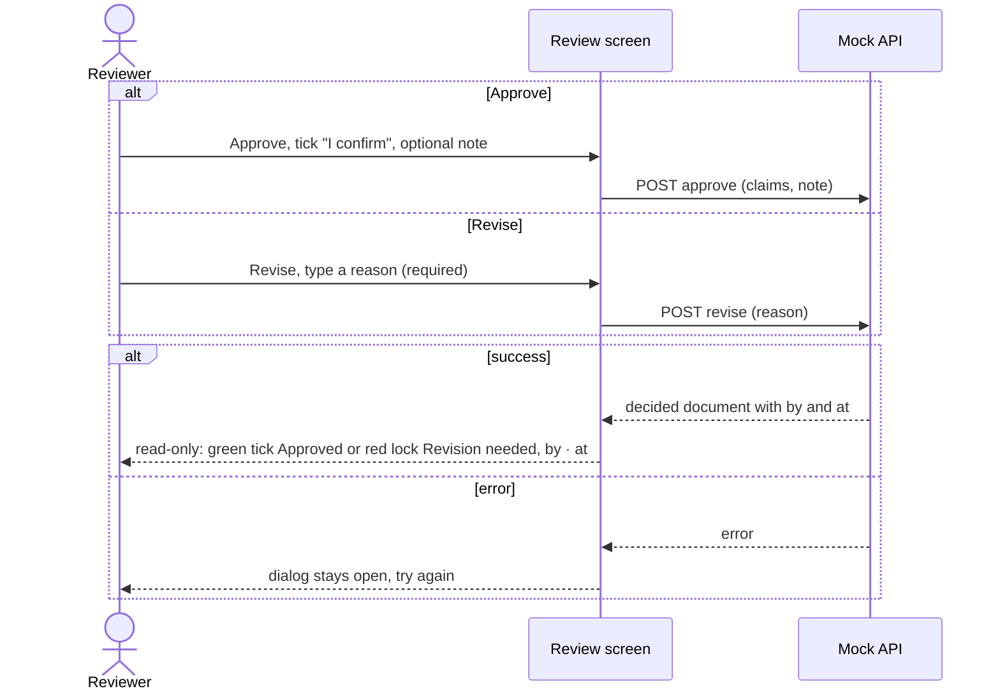
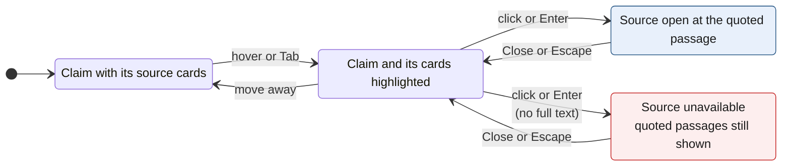

# Architecture

These diagrams are the target the build works toward. Each later PR (screen, inspect, edit,
feedback) updates this file in the same PR if what it builds differs.

## High Level

## Approve Revise

## Sources

